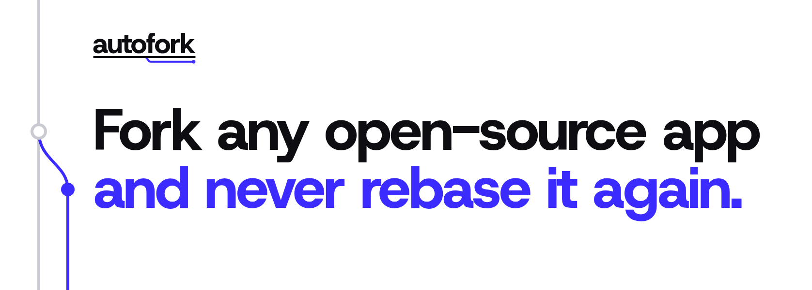

<picture>
  <source media="(prefers-color-scheme: dark)" srcset="assets/header-dark.png">
  
</picture>

Fork anything and keep your changes. autopatch keeps your fork on top of upstream, and when upstream breaks one of your changes, an agent rebuilds it.

```sh
npx github:AVGVSTVS96/autopatch fork pingdotgg/t3code
```

That forks the repo, clones it and adds the autopatch workflow. Set `CLAUDE_CODE_OAUTH_TOKEN` first (`claude setup-token` prints one) and it adds that secret too. Already have a fork? Run `init owner/repo` inside it.

## Patches

Each change you keep is a folder in `.autopatch/`:

```
.autopatch/dark-mode/
├── PATCH.md          what it does and why
└── dark-mode.patch   the diff
```

Change the code, write the `PATCH.md`, and save the diff:

```sh
npx github:AVGVSTVS96/autopatch save dark-mode
```

Or just write the `PATCH.md` and push. The workflow has an agent build it.

A `PATCH.md` is plain prose. Describe what the change does, not which lines it touches, so an agent can rebuild it on whatever upstream looks like next:

```md
Follow the system theme in every view. Upstream hardcodes light colors,
so add a dark palette and switch on prefers-color-scheme.
```

## Updates

The workflow rebuilds your fork from upstream plus your patches. Patches that still apply go in with git. When one doesn't, an agent rebuilds it from its `PATCH.md`, your `verify` command checks the build, and the result is pushed as a signed commit. If upstream already does what a patch asks, the patch is dropped.

It runs on two schedules you can change in `.github/workflows/autopatch.yml`:

| | default | |
| --- | --- | --- |
| update | every 6 hours | git only, no agent. A patch that doesn't apply waits. |
| heal | daily | the agent rebuilds what no longer applies |

A failed heal doesn't retry until upstream or your fork changes. Running the workflow by hand always heals.

## Agents

```sh
npx skills add AVGVSTVS96/autopatch
```

Your agent then knows how to fork a repo and keep its changes as patches.

## Config

`.autopatch/config.json`:

| key | |
| --- | --- |
| `upstream` | `owner/repo`, or any git URL |
| `follow` | a branch, or `releases` for upstream's newest release tag |
| `verify` | the command that checks a build |
| `agent` | the command that rebuilds a patch, prompt on stdin. Default: `claude -p --dangerously-skip-permissions` |
| `green` | `false` to take upstream's newest commit even when its checks failed |

For Codex: `"agent": "codex exec --dangerously-bypass-approvals-and-sandbox"`.

## Commands

```
autopatch fork <owner/repo>   fork it, set it up and push
autopatch init <owner/repo>   set up a fork you already have
autopatch save <id>           save your changes as the patch in .autopatch/<id>
autopatch status              your patches, and changes no patch holds yet
autopatch sync                what the workflow runs
```

`fork` and `init` take `--verify <command>` and `--follow <branch | releases>`.

## History

- **May 2026:** [pi-patcher](https://github.com/AVGVSTVS96/pi-patcher) keeps patches to the [pi](https://github.com/earendil-works/pi-coding-agent) coding agent working across updates. Proof of concept.
- **June:** [PATCH.md](https://patchmd.vercel.app), the format.
- **July:** [herdr](https://github.com/AVGVSTVS96/herdr), the first fork rebuilt from patches. Proof of concept.
- **October:** forks of [Claude Code's plugins](https://github.com/AVGVSTVS96/claude-plugins-official), [Buzz](https://github.com/AVGVSTVS96/buzz) and [T3 Code](https://github.com/AVGVSTVS96/t3code), in daily use.
- **October:** autopatch.

## License

MIT
